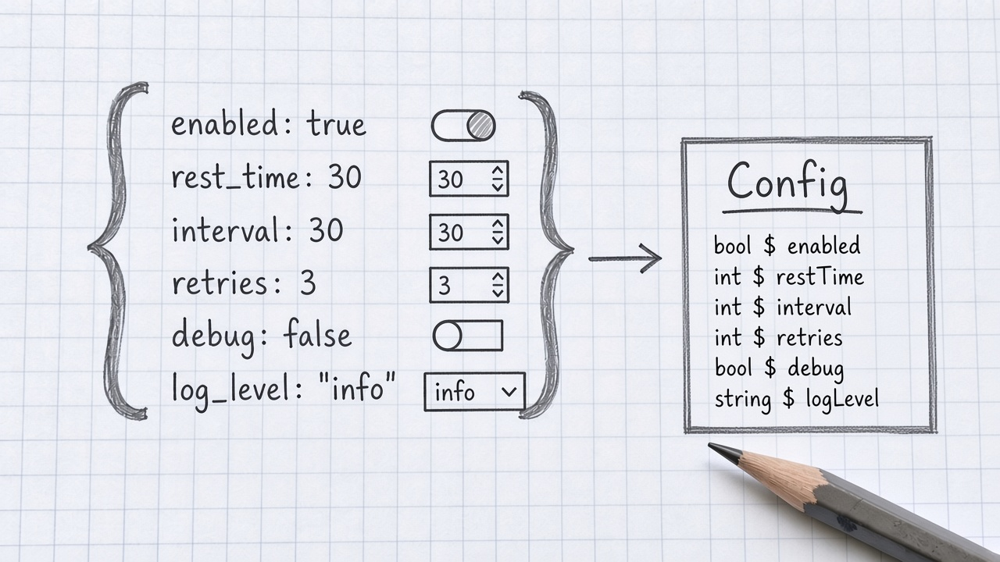
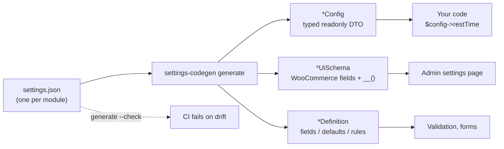

<p align="center"></p>

<p align="center"><b>Describe settings once in <code>settings.json</code> — get typed PHP classes, admin UI fields and validation, checked in CI.</b></p>

<p align="center">

[](https://github.com/tikhomirov/settings-codegen/actions/workflows/ci.yml)
[](https://github.com/tikhomirov/settings-codegen/actions/workflows/ci.yml)
[](phpstan.neon.dist)
[](composer.json)
[](LICENSE)

</p>

# settings-codegen

## The problem

The two most popular ways to read settings in PHP look like this.

**WordPress** — option names are strings, every value is `mixed`:

```php
$enabled = get_option('enabled', 'yes') === 'yes';   // "yes", "1", true, "on"…?
$apiKey  = (string) get_option('api_key', '');
$timeout = (int) get_option('timeout', 30);          // the default lives here…

// …and once more in the settings page definition
['id' => 'timeout', 'type' => 'number', 'title' => __('Timeout, seconds'), 'default' => 30],
```

**Laravel** — `config()` / `env()` are no better:

```php
// config/shop.php
return [
    'enabled' => env('SHOP_ENABLED', true),
    'api_key' => env('SHOP_API_KEY', ''),
    'timeout' => env('SHOP_TIMEOUT', 30),
];

// somewhere in a service
$timeout = (int) config('shop.timeout', 30);   // default repeated, cast by hand
$apiKey  = config('shop.api_kye');             // typo: silently null, no tool notices
```

- **String keys everywhere.** A typo silently returns the default; PHPStan can't see it.
- **Everything is `mixed`.** `get_option()` / `config()` return `"0"`, `0`, `false` or `"no"`, so every call site casts by hand.
- **Defaults are duplicated.** `30` lives in the code *and* in the admin form or config file. Change one, forget the other.
- **A global `SettingsKey` constants class** gives autocomplete for key names only, stays `mixed`, and becomes a God Object every module depends on.
- **UI and code drift apart.** The admin form, the validation rules and the code that reads the values are three separate lists.

## The solution: schema first

**1. Describe the module once**, next to its code — `src/Shop/settings.json`. Only what matters:
an `id`, a label and a default. The property name (`api_key` → `apiKey`) and the PHP type
(`true` → `bool`, `30` → `int`) are derived; a section is just a title with nested fields.

```json
{
    "sections": [
        {
            "title": "Shop API",
            "desc": "Connection to the shop backend.",
            "fields": [
                { "id": "enabled", "title": "Enable integration", "default": true },
                { "id": "api_key", "title": "API key", "default": "", "rules": ["required"] },
                { "id": "timeout", "title": "Timeout, seconds", "default": 30, "rules": ["integer", "min:1"] }
            ]
        },
        {
            "id": "newsletter",
            "title": "Newsletter",
            "fields": [
                { "id": "newsletter_enabled", "title": "Send newsletter", "default": false },
                {
                    "id": "newsletter_lists",
                    "type": "multiselect",
                    "title": "Mailing lists",
                    "options": { "news": "News", "offers": "Offers" },
                    "default": ["news"]
                }
            ]
        }
    ]
}
```

**2. Generate:**

```bash
vendor/bin/settings-codegen generate
```

**3. Get plain, committed PHP.** Real output, shortened. With the `laravel` adapter
(`"key_prefix": "shop."`):

```php
final readonly class ShopConfig
{
    public function __construct(
        public bool $enabled,
        public string $apiKey,
        public int $timeout,
        public bool $newsletterEnabled,
        /** @var array<array-key, mixed> */
        public array $newsletterLists,
    ) {}

    public static function load(\Illuminate\Contracts\Config\Repository $config): self
    {
        return new self(
            enabled: self::bool($config->get('shop.enabled'), true),
            apiKey: self::string($config->get('shop.api_key'), ''),
            timeout: self::int($config->get('shop.timeout'), 30),
            newsletterEnabled: self::bool($config->get('shop.newsletter_enabled'), false),
            newsletterLists: self::array($config->get('shop.newsletter_lists'), [
                'news',
            ]),
        );
    }
    // fromArray(), toArray() and the typed casts
}
// + ShopDefinition: fields(), defaults(), rules(), keys()
```

With the `wordpress` adapter the same schema gives `load()` on top of `get_option()` and a
WooCommerce settings array with both sections, `checkbox` / `text` / `number` field types and
translated labels:

```php
    public static function load(): self
    {
        return new self(
            enabled: self::asBool(\get_option('enabled', 'yes')),
            apiKey: (string) \get_option('api_key', ''),
            timeout: (int) \get_option('timeout', 30),
            // ...
        );
    }

// ShopUiSchema::getFields()
[
    ['title' => \__('Shop API', 'shop'), 'desc' => \__('Connection to the shop backend.', 'shop'), 'type' => 'title'],
    ['id' => 'enabled', 'title' => \__('Enable integration', 'shop'), 'type' => 'checkbox', 'default' => 'yes'],
    ['id' => 'api_key', 'title' => \__('API key', 'shop'), 'type' => 'text', 'default' => ''],
    ['id' => 'timeout', 'title' => \__('Timeout, seconds', 'shop'), 'type' => 'number', 'default' => 30],
    ['type' => 'sectionend'],
    // Newsletter section...
]
```

**4. Use typed values with full autocomplete:**

```php
$shop = ShopConfig::load(app('config'));   // Laravel; WordPress: ShopConfig::load()

if ($shop->enabled) {                      // bool, not "yes"
    $client = new ShopClient($shop->apiKey, timeout: $shop->timeout);
}

$shop->apiKye;                             // PHPStan: Access to an undefined property

$request->validate(ShopDefinition::rules());   // ['api_key' => ['required'], 'timeout' => [...]]
```

Business code depends on a plain object, so unit tests need no database, no framework and no mocks:

```php
public function test_client_uses_configured_timeout(): void
{
    $shop = new ShopConfig(enabled: true, apiKey: 'test', timeout: 5, newsletterEnabled: false, newsletterLists: []);

    $client = ShopClient::fromConfig($shop);   // your code

    $this->assertSame(5, $client->timeout());
}
```

**5. Keep it honest in CI:** `vendor/bin/settings-codegen generate --check` exits with `1` when
someone changed `settings.json` and forgot to regenerate.



## Why use it

- **Single source of truth.** Key, type, default, label and validation rules of a setting live in one JSON entry.
- **Minimal schema.** `id`, label and `default` are enough: property names, PHP types and sections are derived.
- **Type-safe DTOs.** `bool`, `int`, `float`, `string`, `array` properties in a `final readonly` class instead of `mixed`.
- **100% IDE autocomplete** for every setting — no string keys in business code.
- **PHPStan catches typos**: a misspelled property is an error, a misspelled string key never was.
- **Defaults and validation in one place**: `UiSchema::getFields()` / `Definition::defaults()` and `rules()` come from the same schema as the Config class.
- **CI drift check** with `generate --check` (exit codes `0` / `1` / `2`).
- **Zero runtime overhead.** A dev-only dependency: production runs plain generated PHP, cached by OPcache — no JSON parsing, no reflection.
- **Framework-agnostic.** Adapters for WordPress/WooCommerce, Laravel, Symfony, Yii3 and the MoonShine admin panel, or your own `AdapterInterface`.

Read the full rationale (in Russian) →
[“PHP settings architecture: why constants are a dead end, and why JSON”](https://rwsite.ru/php-settings-architecture-why-constants-are-a-dead-end-and-why-json/)

## Requirements

- PHP 8.1+, tested on 8.1, 8.2, 8.3, 8.4 and 8.5 (generated `readonly class` needs 8.2; set
  `"readonly_class": false` for 8.1).
- No runtime dependencies. Framework packages are only suggested.
- Deterministic output: stable order and formatting. You don't need a code style fixer, but the
  output can match one (see `style`).

## Contents

- [The problem](#the-problem)
- [The solution: schema first](#the-solution-schema-first)
- [Why use it](#why-use-it)
- [Requirements](#requirements)
- [Installation](#installation)
- [The schema](#the-schema)
- [Configuration](#configuration)
- [Command line](#command-line)
- [WordPress / WooCommerce](#wordpress--woocommerce)
- [Laravel](#laravel)
- [Symfony](#symfony)
- [Yii3](#yii3)
- [MoonShine](#moonshine)
- [Custom reader](#custom-reader)
- [Extensions and post steps](#extensions-and-post-steps)
- [CI](#ci)
- [For AI agents](#for-ai-agents)
- [Development](#development)

## Installation

```bash
composer require --dev tikhomirov/settings-codegen
```

The package is not on Packagist yet. Until then, add the GitHub repository first:

```bash
composer config repositories.settings-codegen vcs https://github.com/tikhomirov/settings-codegen
composer require --dev tikhomirov/settings-codegen:dev-main
```

`require-dev` is enough: only the generated classes are used at runtime.

## The schema

A module's `settings.json` comes in two formats. Both generate the same code.

### Structured format (recommended)

A JSON object with `fields` (outside of any section) and/or `sections`:

```json
{
    "fields": [
        { "id": "mode", "title": "Mode", "default": "live" }
    ],
    "sections": [
        {
            "id": "api",
            "title": "API",
            "desc": "Connection settings.",
            "fields": [
                { "id": "api_key", "title": "API key", "default": "" },
                { "id": "timeout", "title": "Timeout, seconds", "default": 30 },
                { "id": "token", "property": "secret", "php_type": "string", "ui": false },
                { "id": "help", "type": "info", "text": "See the docs.", "property": false }
            ]
        }
    ]
}
```

- A **section** becomes a `title` entry (every section key except `fields`), its fields and a
  `sectionend`. Its `id` is optional and is used for both the title and the end, as WooCommerce does.
- A **field with an `id`** is a setting. `property` defaults to the camelCase of the storage key
  (`api_key` → `apiKey`, after `strip_prefixes`); `"property": false` makes a UI-only field.
- **`php_type`** is inferred from `default`: `true`/`false` → `bool`, `30` → `int`, `1.5` → `float`,
  `[...]` → `array`, anything else (or no default) → `string`. Set it explicitly when needed.
- **WordPress only:** a missing `type` becomes `checkbox` (bool), `number` (int, float) or `text`
  (string); arrays need an explicit `type` such as `multiselect`. Boolean checkbox defaults are
  written as `"yes"` / `"no"`, the way WooCommerce stores them.
- Titles, sub-headings (`"type": "title"`) and other entries without a value need no `id`.

### Flat list format

A JSON array of WooCommerce-style entries, the original format. It is still fully supported and
is passed through as is: nothing is inferred, `property` must be explicit and `php_type` defaults
to `string`.

```json
[
    { "type": "title", "title": "API" },
    { "id": "api_key", "property": "apiKey", "type": "text", "title": "API key", "default": "" },
    { "id": "timeout", "property": "timeout", "php_type": "int", "type": "number", "title": "Timeout, seconds", "default": 30, "rules": ["integer", "min:1"] },
    { "type": "sectionend" }
]
```

### Keys

| Key | Meaning |
| --- | --- |
| `id` | Storage key / option id, unique in the module. `strip_prefixes` removes prefixes from it for reading. |
| `property` | Property name in the Config class. Structured format: optional, `false` = UI-only. |
| `php_type` | `string`, `int`, `float`, `bool`, `array`. Flat format: defaults to `string`; structured: inferred from `default`. |
| `default` | Default value. With `strict_defaults` (on by default), it must match `php_type`. |
| `ui` | `false` keeps a setting out of the WordPress UI schema. |
| `rules` | Passed through to `Definition::rules()` (Laravel, Symfony, Yii3, MoonShine). |
| `desc_args_expr`, `text_args_expr` | WordPress: PHP expressions for `sprintf()` with the translated text. |
| `options_expr`, `depends_expr` | WordPress: PHP expressions emitted as `options` / `depends`. |

Validation errors point to the place in the file, e.g. `sections[0].fields[1].default: expected a
number for php_type "int"`. The JSON Schema for IDEs is in
`vendor/tikhomirov/settings-codegen/resources/settings.schema.json` (add `"$schema"` to a
structured file to get completion); the generator validates the same rules itself.

## Configuration

Put the configuration in `composer.json` under `extra.settings-codegen`, or in a standalone
`settings-codegen.json`:

```json
{
    "extra": {
        "settings-codegen": {
            "adapter": "wordpress",
            "schemas": ["src/Features/*/settings.json"],
            "namespace": "Acme\\Features\\{module}\\Generated",
            "output": "{dir}/Generated"
        }
    },
    "scripts": {
        "settings:generate": "settings-codegen generate",
        "settings:check": "settings-codegen generate --check"
    }
}
```

The module name is the directory that holds `settings.json`. Without `--config`, the CLI reads
`settings-codegen.json` from the working directory and falls back to `composer.json`.

| Option | Default | Description |
| --- | --- | --- |
| `adapter` | `wordpress` | `wordpress`, `laravel`, `symfony`, `yii3`, `moonshine`, or the FQCN of an `AdapterInterface`. |
| `schemas` | `["settings.json"]` | Glob patterns relative to the project. `**` is supported. |
| `namespace` | `App\Settings\Generated` | Namespace of the generated classes. `{module}` is replaced. |
| `output` | `{dir}/Generated` | Output directory. `{dir}` is the schema's directory, `{module}` the module name. |
| `module_names` | `{}` | Override module names: `{"app/Settings/settings.json": "General"}`. |
| `strip_prefixes` | `[]` | Prefixes removed (repeatedly) from `id` to get the storage key. |
| `key_aliases` | `{}` | Rename schema keys before validation, e.g. `{"key": "id", "type": "php_type"}`. |
| `strict_defaults` | `true` | Check that `default` matches `php_type`. |
| `readonly_class` | `true` | `final readonly class` (8.2+) or `final class` with readonly properties (8.1). |
| `style` | see below | Formatting of generated code. |
| `docs` | English | Docblock lines per class/method (`{module}`, `{source}` and `{file}` placeholders). |
| `bootstrap` | `[]` | PHP files to require first (e.g. classes for your extensions). |
| `extensions` | `[]` | FQCNs of `ExtensionInterface` implementations. |
| `post_steps` | `[]` | FQCNs or `{"class": ..., "options": {...}}` of `PostStepInterface` implementations. |

`style`:

```json
{"align_arrows": false, "list_keys": false, "empty_array": "inline", "indent": "    "}
```

`align_arrows` aligns `=>` like php-cs-fixer/Pint `align_single_space_minimal`.
`list_keys: true` and `"empty_array": "multiline"` reproduce the `var_export()` + Pint look of
older generators byte for byte.

## Command line

```bash
vendor/bin/settings-codegen generate          # write changed files
vendor/bin/settings-codegen generate --check  # write nothing; exit 1 if anything is missing or outdated
vendor/bin/settings-codegen check             # same as generate --check
vendor/bin/settings-codegen generate --config=settings-codegen.json --working-dir=path/to/project
vendor/bin/settings-codegen generate -q       # print errors only
```

| Exit code | Meaning |
| --- | --- |
| `0` | Everything is generated and up to date. |
| `1` | `--check` only: some generated files are missing or outdated (listed in the output). |
| `2` | Error: invalid schema, invalid configuration, unknown argument, or a file cannot be written. |

Generated files are output, not source: never edit them by hand. Change `settings.json` (or the
configuration) and run `generate` again.

## WordPress / WooCommerce

```json
{
    "adapter": "wordpress",
    "schemas": ["src/Features/*/settings.json"],
    "namespace": "Acme\\Features\\{module}\\Generated",
    "option_reader": "get_option",
    "text_domain": "acme",
    "strip_prefixes": []
}
```

Each module gets `{Module}Config` and `{Module}UiSchema`:

```php
final readonly class DeliveryConfig
{
    public function __construct(
        public bool $enableCalendar,
        public int $slotMinutes,
    ) {}

    public static function load(): self
    {
        return new self(
            enableCalendar: self::asBool(\get_option('shop_enable_calendar', 'yes')),
            slotMinutes: (int) \get_option('shop_slot_minutes', 30),
        );
    }
    // toArray(), asBool()
}

// Business code depends on the DTO only:
$slots = new SlotCalculator(DeliveryConfig::load());

// WooCommerce settings tab:
add_filter('woocommerce_get_settings_acme', fn () => DeliveryUiSchema::getFields());
```

`UiSchema` also has `getAllOptionKeys()` (for export or reset, including `ui: false` options) and
`optionIdFor($property)`. Titles, descriptions, tips, placeholders and option labels are wrapped in
`__('…', 'text_domain')`, so `wp i18n make-pot` finds them. Options: `option_reader` (any function
`(string $key, mixed $default): mixed`), `text_domain`, `config_suffix` (`Config`), `schema_suffix`
(`UiSchema`).

## Laravel

```json
{
    "adapter": "laravel",
    "schemas": ["app/Settings/Modules/*/settings.json"],
    "namespace": "App\\Settings\\Generated",
    "output": "app/Settings/Generated",
    "key_prefix": "settings."
}
```

```php
// config/settings.php: ['enable_calendar' => env('DELIVERY_CALENDAR', true), ...]
$config = DeliveryConfig::load(app('config'));      // reads settings.enable_calendar, ...
$config = DeliveryConfig::fromArray($row->values);  // e.g. JSON column from the database

$request->validate(DeliveryDefinition::rules());   // the "rules" key from settings.json
DeliveryDefinition::defaults();                     // storage key => typed default
DeliveryDefinition::fields();                       // raw schema entries, e.g. to build an admin form
```

Values that are missing or have the wrong type fall back to the schema default.

Options of the typed adapters (`laravel`, `symfony`, `yii3`, `moonshine`):

| Option | Default | Description |
| --- | --- | --- |
| `reader` | adapter specific | `{"type", "variable", "expression"}` of `load()`, see [Custom reader](#custom-reader). |
| `key_prefix` | `""` | Prepended to the storage key in `load()`. |
| `config_suffix` / `definition_suffix` | `Config` / `Definition` | Class name suffixes. |
| `definition` | `true` | Generate the Definition class. |
| `string_cast` | `scalar` | `scalar`: any scalar becomes a string; `string`: only strings; `non_empty_string`: only non-empty strings, `""` falls back to the default. |
| `definition_fields` | `normalized` | `Definition::fields()` entries after `key_aliases` (`normalized`) or exactly as written in `settings.json` (`source`). |

`definition_fields: "source"` together with `key_aliases` lets an existing schema with its own key
names (for example `key` / `type`) keep the same `fields()` output that runtime code already reads.

## Symfony

```json
{
    "adapter": "symfony",
    "schemas": ["src/*/Resources/settings.json"],
    "namespace": "App\\Settings\\{module}",
    "output": "src/{module}/Settings",
    "key_prefix": "app.settings."
}
```

```yaml
# config/services.yaml
parameters:
    app.settings.enable_calendar: true
    app.settings.slot_minutes: 15

services:
    App\Settings\Delivery\DeliveryConfig:
        factory: ['App\Settings\Delivery\DeliveryConfig', 'load']
        arguments: ['@parameter_bag']
```

The optional bundle adds a console command:

```php
// config/bundles.php
Tikhomirov\SettingsCodegen\Adapter\Symfony\SettingsCodegenBundle::class => ['dev' => true],
```

```bash
bin/console settings:generate [--check] [--config=settings-codegen.json]
```

## Yii3

```json
{
    "adapter": "yii3",
    "schemas": ["src/*/settings.json"],
    "namespace": "App\\{module}\\Settings",
    "output": "{dir}/Settings",
    "key_prefix": "app.settings."
}
```

```php
// config/common/params.php
return ['app' => ['settings' => ['enable_calendar' => true, 'slot_minutes' => 15]]];

// config/common/di/settings.php
use App\Delivery\Settings\DeliveryConfig;
use Yiisoft\Definitions\DynamicReference;

return [
    DeliveryConfig::class => DynamicReference::to(static fn () => DeliveryConfig::load($params)),
];
```

`load(array $params)` resolves dot-separated keys in nested arrays. The package ships a
`yiisoft/config` plugin (`config/yii3/params-console.php`) that registers the command with
`yiisoft/yii-console`:

```bash
./yii settings:generate [--check]
```

## MoonShine

The `moonshine` adapter generates everything the `laravel` adapter does (`{Module}Config` with
`load()` / `fromArray()` / `toArray()` and `{Module}Definition`) plus `{Module}Fields`: ready
[MoonShine](https://moonshine-laravel.com) form components for an admin settings page.
`moonshine/moonshine` is only suggested; the generated code is checked against the real MoonShine
API (4.x and 5.x) in CI.

```json
{
    "adapter": "moonshine",
    "schemas": ["app/Settings/*/settings.json"],
    "namespace": "App\\Settings\\{module}",
    "output": "{dir}/Generated",
    "key_prefix": "shop.",
    "field_name": "settings_{key_snake}"
}
```

For the [Shop schema above](#the-solution-schema-first) (real output, shortened):

```php
final class ShopFields
{
    /** @return list<\MoonShine\Contracts\UI\ComponentContract> */
    public static function components(): array
    {
        return [
            Box::make(\__('Shop API'), [
                Switcher::make(\__('Enable integration'), 'settings_enabled')
                    ->default(true),
                Text::make(\__('API key'), 'settings_api_key')
                    ->default('')
                    ->required(),
                Number::make(\__('Timeout, seconds'), 'settings_timeout')
                    ->default(30),
            ]),
            Box::make(\__('Newsletter'), [
                Switcher::make(\__('Send newsletter'), 'settings_newsletter_enabled')
                    ->default(false),
                Select::make(\__('Mailing lists'), 'settings_newsletter_lists')
                    ->options([
                        'news' => \__('News'),
                        'offers' => \__('Offers'),
                    ])
                    ->multiple()
                    ->default([
                        'news',
                    ]),
            ]),
        ];
    }

    public static function names(): array;                     // storage key => field name
    public static function values(ShopConfig $config): array;  // field name => value
    public static function input(array $input): array;         // submitted form => storage key => value
}
```

```php
// A MoonShine page
protected function components(): iterable
{
    return [
        FormBuilder::make()
            ->fields(ShopFields::components())
            ->fill(ShopFields::values(ShopConfig::load(app('config'))))
            ->submit(__('Save')),
    ];
}

// Saving: typed and validated with the same schema
$config = ShopConfig::fromArray(ShopFields::input($request->all()));
```

Field component, in order of precedence:

1. `ui.field`: `switcher`, `text`, `textarea`, `markdown` (Textarea), `number`, `select`,
   `password`, `email`, `url`, `color`, `date`, `phone`, `hidden`, `json`. An unknown name is an error.
2. The WooCommerce `type`: `checkbox` → Switcher, `multiselect` → multiple Select, `radio` → Select, …
3. The value: `bool` → Switcher, `options` → Select (multiple for arrays), `array` → Json,
   `string` → Text, `int` / `float` → Number.

Other keys: label from `ui.label` or `title` (falls back to the property name), hint from
`ui.help`, `desc_tip` or `desc`, `ui.placeholder` / `placeholder`, options from `ui.options` /
`options` (a list becomes `0 => …, 1 => …`), `->required()` when `rules` contains `required`,
`ui.attributes` / `custom_attributes` (scalar values) → `customAttributes()`, and
`ui.show_when: {"key", "operator", "value"}` → `showWhen()` on the other field's name.
`"ui": false` hides a setting from the form.

Sections — `title` / `sectionend` entries, structured `sections`, or consecutive fields with the
same `ui.section` — become `Box` components (`"section": "fieldset"` for `Fieldset`).

| Option | Default | Description |
| --- | --- | --- |
| `fields_suffix` | `Fields` | Class name suffix of the fields class. |
| `field_name` | `{key}` | Form field name: `{key}` storage key, `{key_snake}` with non-alphanumerics replaced by `_`, `{property}`. |
| `section` | `box` | `box` or `fieldset`. |
| `translate` | `__` | Function wrapped around labels, hints, placeholders and option labels; `""` for plain strings. |

All typed adapter options (`reader`, `key_prefix`, `string_cast`, …) apply to the Config class;
the default reader is the Laravel config repository, which MoonShine runs on.

## Custom reader

All framework adapters accept a custom reader. For example, a database-backed store:

```json
{
    "adapter": "laravel",
    "reader": {
        "type": "\\App\\Settings\\SettingsStore",
        "variable": "store",
        "expression": "{var}->get({key})"
    }
}
```

This generates `public static function load(\App\Settings\SettingsStore $store): self` with
`$store->get('…')` calls. `{key}` is the exported key literal (with `key_prefix`) and `{var}` is
the variable.

## Extensions and post steps

Extensions own custom schema keys, validate them and add attributes to generated classes.
Post steps run once after all modules and write extra files, such as a registry or an index of
presets:

```php
use Tikhomirov\SettingsCodegen\Extension\AbstractExtension;
use Tikhomirov\SettingsCodegen\Extension\AttributeSpec;
use Tikhomirov\SettingsCodegen\Schema\{Module, Setting};

final class ModesExtension extends AbstractExtension
{
    public function reservedKeys(): array
    {
        return ['default_for_mode']; // never copied to UI arrays
    }

    public function propertyAttributes(Module $module, Setting $setting): array
    {
        $values = $setting->get('default_for_mode');

        return is_array($values) ? [new AttributeSpec(\App\Attribute\Defaults::class, ['values' => $values])] : [];
    }
}
```

```php
use Tikhomirov\SettingsCodegen\{Context, GeneratedFile};
use Tikhomirov\SettingsCodegen\PostStep\PostStepInterface;

final class RegistryPostStep implements PostStepInterface
{
    public function run(array $modules, Context $context, array $options): array
    {
        $names = array_map(fn ($m) => $m->name, $modules);
        $code = "<?php\n\nreturn " . $context->exporter->value($names) . ";\n";

        return [new GeneratedFile($context->config->path($options['path']), $code)];
    }
}
```

```json
{
    "bootstrap": ["tools/codegen.php"],
    "extensions": ["App\\Codegen\\ModesExtension"],
    "post_steps": [{"class": "App\\Codegen\\RegistryPostStep", "options": {"path": "config/settings-registry.php"}}]
}
```

A completely different output is one class away: implement
`Tikhomirov\SettingsCodegen\Adapter\AdapterInterface` and set `"adapter"` to its FQCN.

## CI

```yaml
- run: composer install
- run: vendor/bin/settings-codegen generate --check
```

## For AI agents

The package ships an [Agent Skill](skills/settings-codegen/SKILL.md) that teaches coding agents
how to add settings, regenerate and fix `--check` failures. It is part of the Composer package, so
after installation it is available at `vendor/tikhomirov/settings-codegen/skills/settings-codegen/`.

```bash
# Claude Code
mkdir -p .claude/skills && cp -r vendor/tikhomirov/settings-codegen/skills/settings-codegen .claude/skills/
# Cursor
mkdir -p .cursor/skills && cp -r vendor/tikhomirov/settings-codegen/skills/settings-codegen .cursor/skills/
```

Or reference it from your project's `AGENTS.md`:

```markdown
Settings are generated by tikhomirov/settings-codegen: follow
vendor/tikhomirov/settings-codegen/skills/settings-codegen/SKILL.md.
```

[`AGENTS.md`](AGENTS.md) in this repository is for agents working on the package itself.

## Development

```bash
composer test      # PHPUnit: golden files for every adapter, runtime behaviour, CLI
composer phpstan   # PHPStan level 9, no baseline
composer coverage  # PHPUnit with pcov or Xdebug; fails below 100% lines, methods and classes
composer check     # test + phpstan
UPDATE_GOLDEN=1 composer test   # after an intended output change; review the diff
```

CI runs the tests on PHP 8.1, 8.2, 8.3, 8.4 and 8.5 (plus lowest dependencies on 8.1) with
`E_ALL` and PHPUnit failing on any warning, notice or deprecation, runs the CLI for every adapter
to make sure it prints no deprecations, runs PHPStan, and a coverage job on PHP 8.3 with pcov that fails if line, method or class coverage drops below 100%. The Symfony
packages are in `require-dev`, so the bundle and the console command are covered too; there are no
coverage exclusions.

## License

[MIT](LICENSE)
